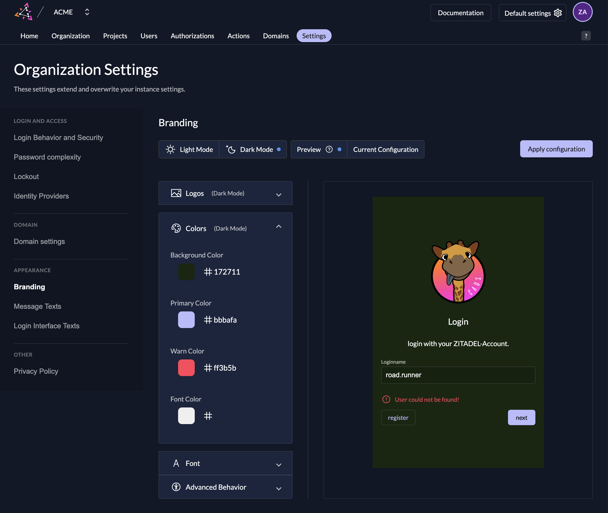

ZITADEL offers various customization options for your projects brand design. The branding can be configured on two different levels.
The settings on the instance level will set the default settings, which are triggered for all users if not overwritten on an organization specifically.
The second possibility is to configure it on each organization. This guide will describe the second possibility.
For this head over to the Branding Setting on your Organization Page.

## How it works

You are able to customize the light and a dark mode separately.
All your changes will be shown in the preview window on the right side.
As soon as you are happy with your settings click the "Apply settings" button.
After this your settings will trigger in your system. The login and the emails will be sent with your branding.

## Settings

### Logo

Upload your logo for the chosen theme, as soon as it is uploaded the preview on the right side of the screen should show it.

### Colors

In the next part you can configure your colors.
Background color is self-explanatory, the primary color will be used for buttons, links and some highlights.
The warn color is used for all the error messages and warnings and the font color for texts.

### Font

Last step to apply to your branding is the font upload.
The best way is to upload a ttf file after a successful upload you will see it in the font part, but not in the preview.

### Link preview

Set the title, description, and image used when a hosted login or Management Console URL is shared in chat or social apps.
These values are sent as Open Graph and Twitter card tags from Login V2, Login V1, and the Management Console.

Leave a field empty to keep the default ZITADEL text. The title can have up to 120 characters and the description up to 300.
The image must be a PNG, JPEG, or WebP file of at most 512 KiB (524 kB), the same limit as logos. A 1200×630 pixel image works well for most chat and social apps.
Organization values override the instance values, the same way colors and logos do.
When an organization starts its own branding, the Management Console copies the instance title and description, but not the image. Upload an image for the organization if its previews should show one.
Removing the image takes effect right away, also on the live login, so upload the new image before you remove the old one. Chat apps cache previews, so a changed preview can take a while to show up.
The Management Console uses the organization values when the shared URL contains the `org` query parameter. Link preview values are public, like the rest of the branding shown on the login page.
Save the preview, then apply the settings so the tags are used on the live login and Management Console.

When you update the branding through the API, requests that leave out `link_preview_title` or `link_preview_description` keep the current values. Send an empty string to clear a value.
To preset the title and description for new instances, set `DefaultInstance.LabelPolicy.LinkPreviewTitle` and `DefaultInstance.LabelPolicy.LinkPreviewDescription` in the runtime configuration.

### Advanced Settings

In the advanced behavior you can choose if the loginname suffix (domain e.g. road.runner@acme.caos.ch) should be shown in the loginname screen or not and if the “ZITADEL watermark” should be hidden.

## Trigger the private labeling for the login

If you like to trigger your settings for your applications you have different possibilities.

### 1. Organization Domain Scope

Send a [reserved scope](/apis/openidoauth/scopes) with your [authorization request](../../integrate/login/oidc/login-users) to trigger your organization.
The Organization Domain scope will restrict the login to your organization, so only users of your own organization will be able to log in.

You can use our [OpenID Authentication Request Playground](https://zitadel.com/playgrounds/oidc) to learn more about how to trigger an [organization's policies and branding](https://zitadel.com/playgrounds/oidc#organization-policies-and-branding).

### 2. Setting on your Project

Set the private labeling setting on your project to define which branding should trigger.

## Reset to default

If you don't like your customization anymore click the "reset policy" button.
All your settings will be removed and the default settings of the system will trigger.
